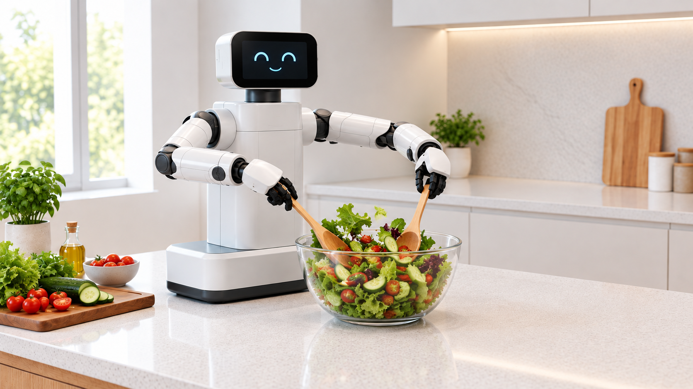
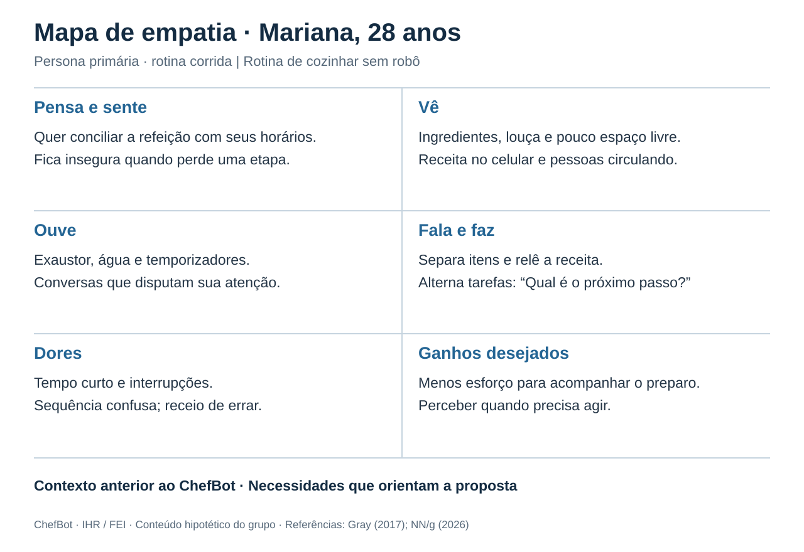
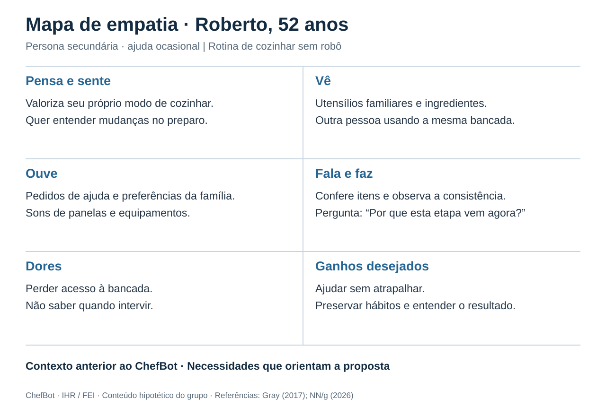
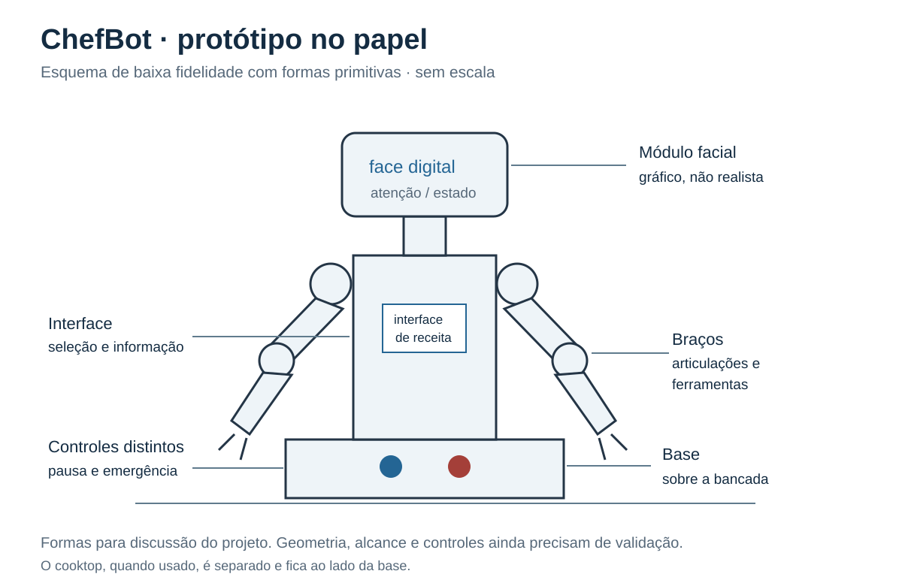
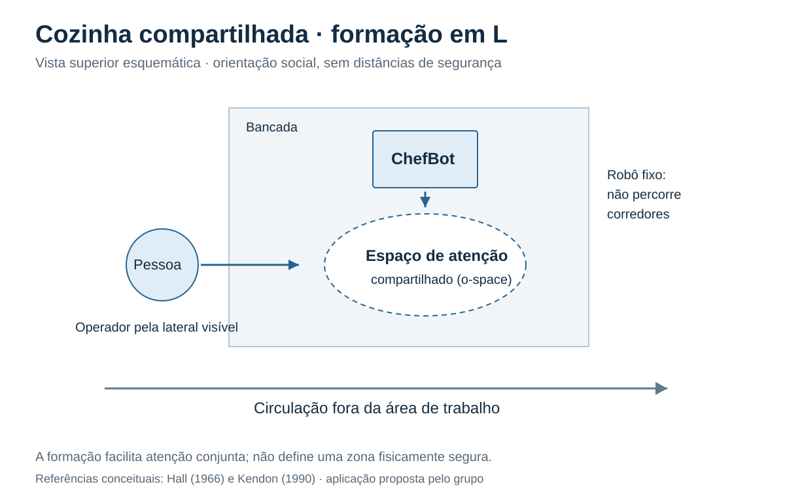

# ChefBot: robô culinário colaborativo para receitas variadas

Trabalho de Interação Humano-Robô (IHR) apresentado ao Centro Universitário [FEI](https://portal.fei.edu.br/), como parte dos requisitos para aprovação na disciplina de Interação Humano-Robô (CCR230), do curso de Engenharia de Robôs, orientado pelo Prof. Dr. [Fagner de Assis Moura Pimentel](https://github.com/fagnerpimentel).

**Estágio do trabalho:** projeto conceitual. A entrega reúne especificação de interação, personas hipotéticas, mapas de empatia, ilustrações e um plano de avaliação. Não houve construção de hardware, implementação funcional ou pesquisa com participantes.

**Entregas:** [PowerPoint](apresentacao/ChefBot_Apresentacao_Final.pptx) · [PDF dos slides](apresentacao/ChefBot_Apresentacao_Final.pdf) · [Roteiro dos quatro apresentadores](apresentacao/roteiro.md) ([PDF](apresentacao/Roteiro_Apresentacao.pdf)) · [Referências](docs/referencias.md) · [Correspondência com o template](docs/requisitos-do-template.md).

**Navegação:** [Pessoas e mapas](#público-alvo-e-stakeholders) · [Contexto e jornada](#contexto-de-uso) · [Concorrência](#análise-de-concorrência) · [Design](#design-do-robô) · [Ações](#ações-do-robô) · [Interações](#interações-do-robô) · [Emoção](#emoção) · [Avaliação futura](#desenvolvimento-conceitual-e-avaliação-futura).

## Componentes do Grupo

| Integrante | RA |
|---|---|
| Nicolas Kuhnast | 11.122.431-7 |
| Thiago Luppi Blumer | 11.122.030-7 |
| Rafael Simões Israel | 11.122.284-0 |
| Caroline Alves Barroso | 11.122.398-8 |

## Resumo

O ChefBot é uma proposta de robô estacionário de bancada, com dois braços e face digital, para colaborar no preparo de receitas variadas. A pessoa escolhe uma receita compatível e disponibiliza ingredientes e utensílios; o robô verifica as condições previstas e coordena ações como dosar, transferir, misturar e montar. A cocção depende de equipamentos compatíveis e de validação específica. O usuário acompanha o estado, pede explicações, pausa o preparo e participa de etapas que excedem a capacidade prevista do sistema.

A contribuição do projeto é uma interação reutilizável entre receitas: a sequência culinária muda, enquanto os mecanismos de acompanhamento, ajuda e controle permanecem consistentes. Uma salada e um molho de tomate ilustram, respectivamente, preparo frio e preparo com calor. Essas cenas descrevem o conceito, não receitas já executadas por um protótipo.

## Introdução

Cozinhar exige organizar ingredientes, acompanhar diferentes etapas e dividir a atenção entre alimentos, utensílios e outras pessoas. Em uma cozinha compartilhada, a automação pode acrescentar dificuldades se seus movimentos, limites e pedidos de ajuda forem pouco compreensíveis. O problema de IHR escolhido é como delegar parte do preparo sem perder a compreensão do que está acontecendo e a possibilidade de intervir.

O ChefBot explora essa questão por meio de um robô de bancada que combina manipulação proposta, comunicação multimodal e participação humana nas exceções. O grupo não pressupõe que todas as pessoas precisem de um robô culinário; investiga sua utilidade para os perfis e o contexto delimitados neste trabalho.

**Objetivo em uma frase:** projetar a interação de um robô culinário colaborativo que auxilie em receitas variadas, mantendo o preparo compreensível e o controle disponível à pessoa.

**Experiência desejada:** prática, previsível e acolhedora, com mensagens curtas na rotina e explicações adicionais quando solicitadas. A presença social da face deve facilitar a comunicação, sem sugerir compreensão humana ou autonomia ilimitada.

A fundamentação de IHR é apresentada por [Goodrich e Schultz](https://doi.org/10.1561/1100000005); as decisões específicas abaixo são propostas do grupo.

## Público-Alvo e Stakeholders

O público principal são adultos que cozinham em casa, dispõem de uma bancada compatível e desejam apoio em tarefas repetitivas ou sequenciais. O contexto de referência é uma cozinha doméstica compartilhada, com ingredientes disponíveis e supervisão humana. Crianças não são operadoras previstas.

O projeto considera diferenças de experiência culinária, familiaridade digital, mobilidade, visão, audição e hábitos alimentares. A viabilidade econômica e a aceitação social ainda não foram estudadas; não há preço ou promessa de acesso universal.

### Stakeholders

| Categoria | Quem participa | Interesse ou impacto |
|---|---|---|
| Primários | Adulto que seleciona receitas, prepara as entradas e acompanha o robô regularmente | Praticidade, compreensão, qualidade do preparo e controle |
| Secundários | Morador que auxilia ocasionalmente; pessoa responsável por limpeza ou manutenção | Acesso à bancada, interrupção compreensível, higiene e manutenção |
| Terciários | Pessoas que consomem a refeição sem operar o robô; fornecedores e responsáveis pelo desenvolvimento | Qualidade dos alimentos, restrições alimentares, requisitos de projeto e efeitos da adoção |

As categorias descrevem o papel no cenário, não uma característica permanente da pessoa. Um morador pode ser operador principal em outro uso. Fabricantes e desenvolvedores também participariam das decisões técnicas, embora não operem o robô durante a refeição.

### Personas

**As personas são hipóteses de design, não participantes entrevistados.** Os contextos sociais, econômicos e culturais abaixo delimitam os cenários de análise e precisam ser investigados em pesquisa futura.

| Aspecto | Mariana — persona primária | Roberto — persona secundária |
|---|---|---|
| Perfil | 28 anos; profissional com rotina corrida e experiência culinária básica | 52 anos; cozinheiro doméstico experiente e morador que auxilia pontualmente |
| Contexto social | Divide a cozinha e concilia o preparo com compromissos de trabalho | Compartilha utensílios e receitas com familiares; circula pela cozinha durante o uso |
| Contexto econômico | Considera tempo, desperdício e espaço de bancada ao avaliar um equipamento | Valoriza durabilidade e aproveitamento dos utensílios disponíveis; custo é critério de adoção |
| Contexto cultural | Costuma preparar refeições simples e consultar receitas digitais | Prefere receitas familiares e ajustar temperos; não quer perder seus hábitos |
| Objetivo | Preparar uma refeição sem se perder na sequência | Ajudar quando necessário, entender o andamento e preservar suas preferências |
| Dificuldade | Interrupções, pouco tempo e incerteza sobre o próximo passo | Decisões pouco explicadas e interferência na cozinha compartilhada |
| Papel no cenário | Seleciona, prepara as entradas e acompanha o ciclo cotidiano | Consulta o estado, fornece um utensílio ou ajuda em uma etapa externa ocasional |

Antes da tarefa, o robô precisaria conhecer a receita e as porções, as restrições alimentares informadas, a modalidade de comunicação escolhida e quem acompanha o ciclo. Nome completo, idade e perfil socioeconômico não são necessários para executar uma receita. Restrições alimentares devem orientar a seleção, sem prometer detecção infalível de alérgenos ou ausência de contaminação.

### Mapa de empatia

Os mapas retratam a **rotina de cozinhar antes do ChefBot, sem o robô**. O que a pessoa vê, ouve, pensa, sente, fala e faz pertence ao contexto atual da cozinha. Dores e ganhos desejados orientam a construção da solução; não descrevem uma experiência de uso do produto pronto.

A ordem de exposição segue o template: a persona define quem está sendo considerado e o mapa aprofunda sua perspectiva. A sequência de raciocínio do projeto é **contexto atual → necessidades mapeadas → requisitos → proposta do ChefBot**. As implicações para o robô ficam fora dos mapas.

Todos os itens são hipóteses autorais. Em uma pesquisa futura, cada observação deveria ser associada à sua evidência. As falas ilustrativas não são depoimentos reais. Referências metodológicas: [Gray](https://medium.com/@davegray/updated-empathy-map-canvas-46df22df3c8a) e [Nielsen Norman Group](https://www.nngroup.com/articles/empathy-mapping/).

#### Mariana — primária

| Campo | Hipóteses sobre Mariana |
|---|---|
| Pensa e sente | Quer comer em casa sem comprometer os outros horários. Fica insegura quando perde o ponto de uma etapa. |
| Vê | Ingredientes, louça e pouco espaço livre na bancada; receita aberta no celular e pessoas circulando. |
| Ouve | Exaustor, água, temporizadores e conversas que competem pela atenção. |
| Fala e faz | Separa ingredientes, relê a receita e alterna entre tarefas. Uma fala possível seria: “Qual é o próximo passo?” |
| Dores | Tempo curto, interrupções, sequência confusa e receio de errar ou se queimar. |
| Ganhos desejados | Concluir a refeição com menos esforço de acompanhamento e perceber quando precisa agir. |

**Implicação para o projeto:** mostrar etapa e progresso de forma concisa, permitir consulta e pausa e chamar a pessoa quando houver uma necessidade concreta. Essa é uma decisão de design derivada das hipóteses, e não um item de comportamento observado.

#### Roberto — secundária

| Campo | Hipóteses sobre Roberto |
|---|---|
| Pensa e sente | Valoriza o próprio modo de cozinhar e quer entender mudanças no preparo. Desconfia de decisões que não consegue explicar. |
| Vê | Utensílios familiares, ingredientes em diferentes etapas e outra pessoa usando a bancada. |
| Ouve | Pedidos de ajuda, preferências da família e sons de panelas e equipamentos. |
| Fala e faz | Confere ingredientes, observa a consistência e oferece ajuda. Uma fala possível seria: “Por que esta etapa vem agora?” |
| Dores | Perder acesso à bancada, não saber quando intervir e ter preferências ignoradas. |
| Ganhos desejados | Ajudar sem atrapalhar, preservar hábitos culinários e compreender o resultado esperado. |

**Implicação para o projeto:** explicar ações sob demanda, indicar o espaço de trabalho e solicitar ajuda com clareza; mudanças de receita precisam ocorrer dentro de parâmetros previstos.

## Contexto de uso

O cenário principal é uma cozinha doméstica, em período de preparo de uma refeição, com iluminação e ruído variáveis. A base do ChefBot permanece apoiada em bancada estável. Para receitas quentes, o cooktop é um equipamento separado, posicionado ao lado; o robô não fica sobre a fonte de calor.

A cozinha é compartilhada: alguém pode buscar um copo, conversar ou ajudar sem assumir a operação. Diferenças de orçamento, espaço, altura da bancada, idioma e costumes culinários influenciam o projeto. A interface deve usar português claro, unidades compreensíveis e nomes de ingredientes revisáveis; não deve tratar uma receita ou preferência cultural como universal.

Antes de iniciar, o sistema precisaria conhecer:

- Receita, quantidades, sequência, utensílios e etapas atribuídas à pessoa.
- Posição da base, recipientes e equipamentos, além da área de trabalho e da circulação.
- Disponibilidade das ferramentas e compatibilidade das entradas.
- Estado dos controles de pausa e emergência e condições específicas da tarefa, inclusive calor quando aplicável.

Compatibilidade, alcance, estabilidade e condições seguras são requisitos a validar. As cotas e as imagens deste trabalho não estabelecem distâncias de segurança.

## Jornada do usuário

**Narrativa principal:** Mariana chega à cozinha para preparar uma salada. Roberto usa o mesmo ambiente e pode ajudar. A cena abaixo é um storyboard de interação proposto.

| Etapa | Pessoa e ambiente | Resposta proposta do ChefBot | Interação |
|---|---|---|---|
| 1. Primeiro contato | Mariana se posiciona na área de operação, com braços do robô recolhidos | Face se orienta para ela; apresenta sua função e aguarda acionamento | Espacial e não verbal |
| 2. Escolha | Seleciona salada e informa porções e restrições | Exibe ingredientes, utensílios, limites e etapas humanas | Verbal e visual |
| 3. Preparação | Lava e corta os ingredientes; dispõe recipientes e ferramentas | Aguarda; indica visualmente os locais previstos | Espacial e não verbal |
| 4. Verificação | Confere a lista e solicita início | Verifica as entradas pelos meios previstos; se faltar algo, explica e não inicia | Verbal e visual |
| 5. Preparo | Mariana acompanha sem orientar cada movimento | Anuncia o próximo movimento relevante, transfere e mistura conforme o roteiro proposto; exibe estado | Verbal, não verbal e espacial |
| 6. Cozinha compartilhada | Roberto se aproxima para pegar um utensílio | Se houver interferência na área de trabalho, suspende a progressão, sinaliza e pede liberação | Espacial, verbal e não verbal |
| 7. Consulta e ajuda | Mariana pergunta “Qual etapa?”; Roberto oferece um recipiente | Informa estado; quando uma ação humana for necessária, explicita o pedido e aguarda | Verbal e não verbal |
| 8. Interrupção | Mariana aciona pausa | Exibe “Pausado”; a resposta de movimentos e equipamentos segue a condição definida para a tarefa | Verbal e visual |
| 9. Retomada e conclusão | A pessoa verifica a condição e escolhe continuar | Revalida pré-condições; ao terminar, comunica a conclusão e mantém ferramentas em condição prevista | Verbal, não verbal e espacial |
| 10. Último contato | Retira a refeição e organiza a limpeza | Informa o fim do ciclo e orienta as etapas manuais de limpeza previstas | Verbal e visual |

**Variação com calor:** no molho de tomate, o roteiro inclui mistura e cocção com cooktop compatível. Pausa, falha e emergência precisam considerar também a fonte térmica e o calor residual. Interromper o braço não significa eliminar esses riscos. Essa variação mantém a mesma lógica de interação, mas exige análise técnica própria.

Não há rotina universal para todos os pratos. Ingredientes, parâmetros, ferramentas e responsabilidades devem ser definidos por receita. [Fluxo e estados detalhados](docs/fluxo-e-arquitetura.md).

## Análise de concorrência

Comparação qualitativa das funções descritas pelos fabricantes e fornecedores oficiais, consultados em 12 de novembro de 2026. “Limitação para o cenário” é uma avaliação de adequação do grupo, não um resultado de teste dos produtos.

| Plataforma | Proposta documentada | Aspecto favorável como referência | Limitação para o cenário do ChefBot |
|---|---|---|---|
| [Moley Robotic Kitchen](https://www.moley.com/) | Cozinha robótica integrada, voltada também ao mercado residencial de luxo | Manipulação e receitas integradas ao ambiente | A instalação envolve a cozinha; difere da proposta de unidade de bancada |
| [Posha](https://www.posha.com/how-posha-works) | Robô doméstico de bancada; usuário carrega ingredientes e seleciona uma receita | Referência próxima para seleção, preparação das entradas e acompanhamento | O preparo depende do sistema de recipientes, panela e etapas suportadas; não equivale a braços gerais |
| [BOTINKIT Omni](https://emea.softbankrobotics.com/botinkit-omni) | Robô de cocção para operações comerciais, com dosagem, movimento de panela e controle térmico | Sequências e parâmetros reutilizáveis entre preparos | Escala e ambiente comercial diferem da cozinha doméstica compartilhada |
| [Thermomix TM7](https://benelux.vorwerk.com/products/thermomix-tm7) | Aparelho multifunção com preparo guiado | Alternativa para organização de receitas e interação visual | Usa recipiente e acessórios próprios, sem a manipulação proposta por braços |

Moley, Posha e BOTINKIT são as três referências robóticas. Thermomix complementa a análise como outra plataforma de preparo, evitando pressupor que toda solução de cozinha tenha a mesma morfologia.

**Referências mais próximas:** Posha para a rotina de carregar entradas e acompanhar receitas; Moley para a relação entre manipulação e ambiente. O ChefBot diferencia sua proposta pela investigação da comunicação social, da cozinha compartilhada e da possibilidade de intervenção. Isso não demonstra superioridade, menor custo ou melhor desempenho.

## Design do Robô

### Forma, função e affordances

O corpo estacionário comunica uma área localizada de trabalho; os dois braços sugerem manipulação; a face digital sinaliza atenção. A face não deve ser confundida com um painel de toque: os controles propostos ficam em uma interface própria, acompanhada de comandos físicos identificáveis.

O projeto distingue possibilidade de ação e sinalização: o botão permite acionar uma função, enquanto rótulo, posição e feedback ajudam a reconhecê-la. Essa distinção segue [Norman](https://jnd.org/books/the-design-of-everyday-things-revised-and-expanded-edition/).

| Elemento | Função e sinalização pretendidas | Cuidado de acessibilidade |
|---|---|---|
| Face digital | Atenção e estado comunicativo | Acompanhada por texto e voz; não depender da expressão |
| Braços e ferramentas | Indicar e executar ações previstas | Avisar movimentos relevantes; manter acesso aos controles |
| Interface de receita | Seleção, etapa atual, explicação e pausa | Texto legível, contraste, linguagem simples e repetição |
| Pausa e emergência | Funções distintas e identificáveis | Via física ou equivalente não vocal; não depender só de fala ou cor |
| Área de ingredientes | Sinalizar onde apresentar as entradas | Organização compreensível e alcance a avaliar com usuários |

**Gerenciamento de expectativas:** apresentar o ChefBot como assistente de receitas compatíveis, informando o que depende da pessoa. Uma mão ilustrada não comprova destreza; uma face amigável não significa conversa irrestrita. A proposta é prometer apenas o escopo descrito e avaliar se o uso é mais claro do que essa expectativa inicial.

### Grau de antropomorfismo

No espectro máquina ↔ humano, o ChefBot fica próximo de uma máquina com **antropomorfismo moderado**: corpo mecânico, dois braços e face gráfica simplificada. Não é um androide nem tenta reproduzir pele, expressões ou anatomia humana de forma realista.

Essa escolha busca tornar atenção e manipulação reconhecíveis sem criar a expectativa de um cozinheiro humano completo. Para este contexto, o grupo considera essa combinação mais adequada do que uma aparência humana realista, mas sua aceitação ainda precisa ser avaliada. Evitar realismo facial é uma estratégia para reduzir o risco de estranheza, não uma garantia de aceitação.

### Padrões de design

O projeto adapta dois padrões descritos por [Kahn et al. (2008)](https://doi.org/10.1145/1349822.1349836):

1. **Comunicação didática:** apresentar entradas e etapas, explicando o motivo de uma ação quando a pessoa pede. A rotina usa mensagens curtas; não há narração constante nem confirmação a cada movimento.
2. **Recuperação de erros:** reconhecer uma falha, comunicar o que interrompeu o preparo e indicar como a pessoa pode ajudar, sem culpá-la ou reiniciar automaticamente.

**Combinação:** se faltar uma ferramenta, o robô interrompe e explica qual item está ausente e por que ele é necessário. Depois de sua colocação, revalida a condição e aguarda a decisão de retomar. A explicação torna a recuperação compreensível; a recuperação dá consequência prática à explicação.

### Valores e ética

Aplicando o [Value Sensitive Design](https://cseweb.ucsd.edu/~goguen/courses/271/friedman04.pdf), o projeto prioriza dois valores:

- **Autonomia humana:** permitir compreender, interromper e decidir pela retomada. Reduzir esforço rotineiro não deve retirar o controle da pessoa.
- **Segurança:** tornar limites e estados claros e analisar os perigos de cada tarefa. Conveniência e rapidez não justificam contornar pré-condições.

**Risco ético principal:** a face amigável e as ilustrações podem incentivar confiança acima da capacidade real, levando alguém a se aproximar de ferramentas ou acreditar que toda receita é compatível. **Mitigação proposta:** comunicar limites na seleção, vincular fala e sinais ao estado real, manter controles acessíveis e bloquear situações não previstas.

Privacidade e inclusão atravessam esses valores: informar sensores ativos, minimizar dados, oferecer alternativas à voz e evitar reconhecimento emocional categórico. Não há alegação de certificação ou salvaguarda implementada.

### Protótipo no papel

O protótipo esquemático usa um paralelepípedo para a base, um corpo vertical, um módulo facial arredondado, cilindros/articulações para os braços e indicação dos controles. Serve para discutir posição da face, alcance percebido e divisão da bancada. É uma representação de baixa fidelidade, sem escala.

As cotas herdadas do estudo são preliminares: altura total de 700 mm, largura de 380 mm, profundidade da base de 350 mm, alcance nominal de cada braço de 350 mm e módulo facial de 120 mm. Não foram verificadas estrutural ou ergonomicamente. O esboço e as [vistas conceituais fornecidas](assets/conceito/desenho_tecnico_cotado.png) não são desenhos para fabricação.

## Ações do robô

Cada ação abaixo descreve um comportamento pretendido; não uma capacidade implementada.

| Ação | Pré-requisitos | Resultado esperado no ambiente ou no sistema |
|---|---|---|
| Selecionar receita | Escolha da pessoa dentro do catálogo compatível | Receita, porções e responsabilidades definidas |
| Apresentar requisitos | Receita estruturada carregada | Pessoa conhece ingredientes, ferramentas e etapas humanas |
| Verificar entradas | Itens apresentados e métodos de verificação definidos | Início autorizado apenas se compatível; caso contrário, pendência explicada |
| Dosar | Ingrediente, ferramenta e quantidade especificados | Quantidade prevista disponibilizada no recipiente |
| Transferir | Item identificado; origem, destino e trajetória previstos | Ingrediente chega ao recipiente indicado |
| Misturar ou sovar | Ferramenta, recipiente, parâmetros e condições da ação definidos | Etapa progride até o critério especificado; sova depende da viabilidade mecânica |
| Montar ou finalizar | Componentes prontos e sequência prevista | Preparo organizado conforme a receita |
| Realizar cocção | Equipamento compatível, parâmetros e salvaguardas validados | Evolução térmica acompanhada até o critério da receita |
| Explicar | Estado atual e motivo da decisão disponíveis | Pessoa recebe informação; consulta não contorna limites nem muda a sequência |
| Solicitar ajuda | Etapa humana ou exceção identificada | Progressão suspensa quando necessário; pedido e responsabilidade explícitos |
| Pausar ou interromper | Comando ou evento detectado | Sistema aplica a resposta definida para a tarefa; estado fica visível |
| Retomar | Causa resolvida, condições revalidadas e decisão humana apropriada | Continuação deliberada; sem retomada automática após falha ou emergência |
| Concluir | Critérios da receita e condição final verificados | Conclusão informada e área liberada conforme o procedimento previsto |

## Interações do robô

### Espacial

**Posicionamento:** o robô é estacionário; não se aproxima pelo chão nem percorre corredores. A pessoa chega pela frente ou pela lateral visível. A face se orienta para ela, os braços permanecem recolhidos durante a apresentação e a área de preparo fica à frente.

Como referência social de proxêmica de Hall, o estudo adota a zona **pessoal** (aproximadamente 0,45–1,20 m) na operação individual e a **social** (aproximadamente 1,20–3,60 m) para observadores. Evita-se projetar contato na zona íntima como requisito de uso. Esses intervalos são referências culturais de comunicação, **não distâncias de segurança** ou limites de movimento. A geometria real exige análise própria.

A formação proposta é em **L**, com pessoa e robô orientados para um espaço compartilhado de atenção na bancada, o o-space. A circulação permanece fora desse espaço. Esse uso adapta o conceito de F-formations de [Kendon](https://books.google.com/books/about/Conducting_Interaction.html?id=7-8zAAAAIAAJ).

| Interação | Pré-requisito | Comportamento proposto | Resposta emocional esperada |
|---|---|---|---|
| Iniciar contato | Pessoa em posição visível e acionamento intencional | Orientar face, apresentar função e aguardar | Sentir-se reconhecida, sem ser surpreendida |
| Indicar próximo movimento | Entrada validada e trajetória permitida | Orientar olhar/indicador e avisar antes do deslocamento relevante | Previsibilidade |
| Compartilhar bancada | Pessoa próxima ou circulação detectada | Suspender progressão se houver interferência e pedir liberação | Confiança de que sua presença foi considerada |
| Entregar o turno à pessoa | Etapa manual prevista e condição apropriada | Recolher ferramenta, indicar local e aguardar | Clareza e controle |
| Encerrar | Tarefa e condição final verificadas | Comunicar conclusão e liberar acesso conforme o procedimento | Alívio e compreensão do fim da tarefa |

**Pessoas paradas, em conversa ou em grupo:** por não ser móvel, o ChefBot não atravessa grupos. Os braços também não devem passar entre pessoas ou invadir uma conversa para chamar atenção. Se a bancada estiver ocupada, o comportamento previsto é aguardar e sinalizar. Deslocamento em corredor não se aplica a esta morfologia.

**Ajuste para outro contexto:** numa demonstração em sala de aula, separar a área do operador da área social dos observadores, aumentar o tamanho da informação visual e impedir que a aproximação do público inicie o preparo. As zonas devem ser avaliadas com o layout real.

### Verbal

A proposta usa **comandos restritos associados a uma máquina de estados**, porque o preparo envolve ações com consequências físicas e o vocabulário pode ser delimitado. Um modelo de linguagem poderia apoiar explicações futuras a partir do estado e da receita, sem comandar atuadores ou substituir as verificações.

| Interação | Pré-requisito | Exemplo de mensagem proposta | Resposta emocional esperada |
|---|---|---|---|
| Selecionar e iniciar | Receita compatível e verificação concluída | “Salada selecionada. Entradas conferidas. Deseja iniciar?” | Entendimento do compromisso assumido |
| Consultar estado | Estado disponível | “Estou misturando. A próxima etapa é finalizar.” | Orientação |
| Pedir explicação | Motivo disponível no roteiro | “Esta mistura distribui o tempero antes da montagem.” | Compreensão |
| Corrigir ausência ou erro | Pendência identificada | “Falta o recipiente indicado. Vou aguardar.” | Confiança sem culpabilização |
| Pausar e retomar | Evento reconhecido; retomada revalidada | “Preparo pausado.” / “Condição verificada. Você pode escolher continuar.” | Controle |
| Concluir | Critérios de término e condição final atendidos | “Esta receita foi concluída. Acompanhe as orientações para retirar o preparo.” | Clareza |

**Timing:** confirmar visualmente a recepção de um comando; se o processamento demorar, informar “Verificando os itens” e mostrar atividade. Não emitir sinais de concordância que possam ser confundidos com autorização. Interrupções e comandos de pausa têm prioridade sobre explicações. A latência e os tempos de espera precisam ser medidos em protótipo.

**Voz:** TTS em português brasileiro, tom calmo, articulação clara, velocidade e volume ajustáveis. A voz deve combinar com a face simples, sem dramatização humana ou tom infantil.

**Limitação de reconhecimento:** exaustor, água e conversas podem mascarar comandos. A mitigação proposta é vocabulário curto, feedback do que foi reconhecido e alternativa visual/física. Diante de ambiguidade, pedir esclarecimento; não iniciar ou retomar por suposição. Emergência não depende exclusivamente da voz.

### Não-verbal

Os dois canais centrais são **olhar** e **gesto/postura dos braços**. Luz e texto complementam os estados.

| Canal e interação | Pré-requisito | Uso proposto | Resposta emocional esperada |
|---|---|---|---|
| Olhar para quem fala | Pessoa localizada de forma suficiente para orientar a face | Indicar atenção durante uma consulta | Reconhecimento |
| Olhar para o recipiente | Próxima ação e destino definidos | Antecipar o foco da manipulação | Previsibilidade |
| Gesto de indicação | Local conhecido e gesto permitido | Indicar o recipiente ou entrada, acompanhado de texto | Compreensão |
| Recolhimento/espera | Transferência de turno ou pausa em condição apropriada | Retirar a ferramenta da região de acesso prevista | Conforto para agir |

**Percepção das pistas humanas:** câmera de profundidade ou método equivalente é uma possibilidade para localização e postura; microfone atende comandos. Orientação aproximada de cabeça e corpo pode sugerir atenção, e uma mão na área pode indicar interferência. Nenhuma dessas pistas prova intenção ou emoção; ações relevantes dependem de confirmação e verificação. Sensores e algoritmos ainda não foram escolhidos ou implementados.

**Falha de coordenação:** dizer “Pode colocar o recipiente” enquanto o braço ainda atravessa o local torna o convite ambíguo. O pedido deve ocorrer somente após a condição prevista para a participação humana, com olhar, gesto e texto coerentes.

**Pista exclusiva do robô:** um indicador luminoso segmentado de etapa, acompanhado por número e texto, pode mostrar “etapa 2 de 4”. Não possui equivalente corporal humano direto e não deve ser usado isoladamente para comunicar condição segura.

## Emoção

O modelo escolhido é o **circumplexo de Russell**, que organiza o afeto por valência e ativação. Ele permite discutir, por exemplo, satisfação tranquila e tensão, sem exigir expressões faciais realistas. O modelo é uma referência para projetar respostas, não um método que, sozinho, detecte emoções. [Russell, 1980](https://doi.org/10.1037/h0077714).

**Percepção proposta:** priorizar o que a pessoa comunica (“não entendi”, “estou com receio”) e escolhas explícitas de ajuda. Repetição de perguntas, aumento de volume da voz e recuo corporal podem servir como pistas incertas para oferecer esclarecimento. Não concluir “usuário com raiva” apenas por rosto, idade, sotaque ou voz. Em dúvida, perguntar de modo simples: “Quer que eu explique esta etapa?”.

| Situação hipotética | Resposta proposta | Mimetismo |
|---|---|---|
| Pessoa demonstra satisfação ao concluir | Tom positivo breve e face alegre discreta | Pode acompanhar entusiasmo, sem exagero |
| Pessoa demonstra dúvida ou receio | Tom calmo, explicação e opção de pausar | Não imitar ansiedade |
| Pessoa fala com irritação | Reconhecer o problema, reduzir carga de fala e oferecer ação concreta | Nunca retribuir raiva ou ironia |
| Estado emocional não está claro | Manter tom neutro e oferecer ajuda | Não atribuir emoção |

As expressões de espera, processamento e erro são **sinais operacionais** separados do modelo emocional. Um erro precisa de texto e orientação, mesmo quando a face muda.

**Risco de expectativa:** uma face responsiva pode sugerir empatia humana, conversa aberta ou conhecimento das preferências. O ChefBot deve explicitar seu escopo e não alegar sentir emoções ou compreender estados internos. A utilidade e a aceitação dessas respostas precisam ser avaliadas.

## Desenvolvimento conceitual e avaliação futura

O trabalho documenta definição do problema, delimitação de contexto, construção de personas hipotéticas, mapas, análise de referências, decisões de design e especificação de jornadas e interações. As ilustrações apoiam a discussão da forma; não constituem um protótipo funcional.

A próxima etapa proposta é um protótipo de interface/storyboard, com salada e molho de tomate, seguido de avaliação de compreensão. A eventual implementação física é posterior à definição de tarefas, análise de risco e validação das salvaguardas.

| Cenário de avaliação proposto | O que observar |
|---|---|
| Escolher uma receita e preparar entradas | Se a pessoa distingue ações humanas das ações do robô |
| Identificar a etapa e pedir explicação | Se compreende o andamento e o motivo da ação |
| Item ausente ou comando ambíguo | Se entende por que não iniciou e como corrigir |
| Outra pessoa entra na cozinha | Se o pedido de liberação e a divisão espacial são compreendidos |
| Pausa, falha e retomada | Se distingue os estados e mantém decisão sobre continuar |
| Comparar preparo frio e quente | Se percebe os requisitos adicionais do calor |

Registrar completude das tarefas, pedidos de ajuda, erros de interpretação, tempo de localização dos controles e comentários dos participantes. Definir critérios de aceite antes da coleta; não apresentar metas como resultados. Usabilidade percebida não comprova segurança física. [Escopo e limites](docs/escopo-e-avaliacao.md).

## Organização da entrega

- **README:** texto completo do projeto na estrutura solicitada.
- **assets:** mapas, esboços e ilustrações conceituais.
- **docs:** escopo, arquitetura, referências e correspondência com os requisitos.
- **apresentacao:** PowerPoint, PDF e roteiro separado por apresentador.

Esta versão é a referência consolidada. Materiais anteriores foram preservados pelo grupo fora desta publicação para evitar que versões contraditórias sejam confundidas com a entrega vigente.

## Referências

As fontes completas, datas de consulta e sua aplicação estão em [Referências bibliográficas](docs/referencias.md).

Estrutura adaptada do [template de IHR de Fagner Pimentel](https://github.com/FagnerPimentel-Academic/template-ihr), versão consultada em 12/11/2026. Textos, cenários e decisões sobre o ChefBot são a consolidação do projeto do grupo. As imagens fornecidas são tratadas como ilustrações conceituais; não documentam eventos ou equipamentos construídos.
